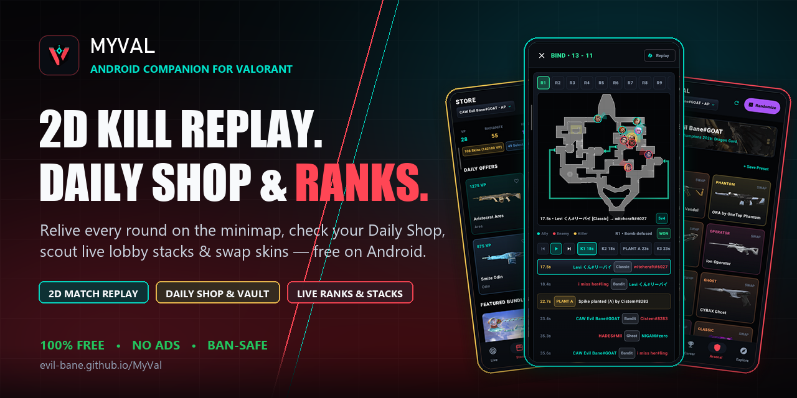
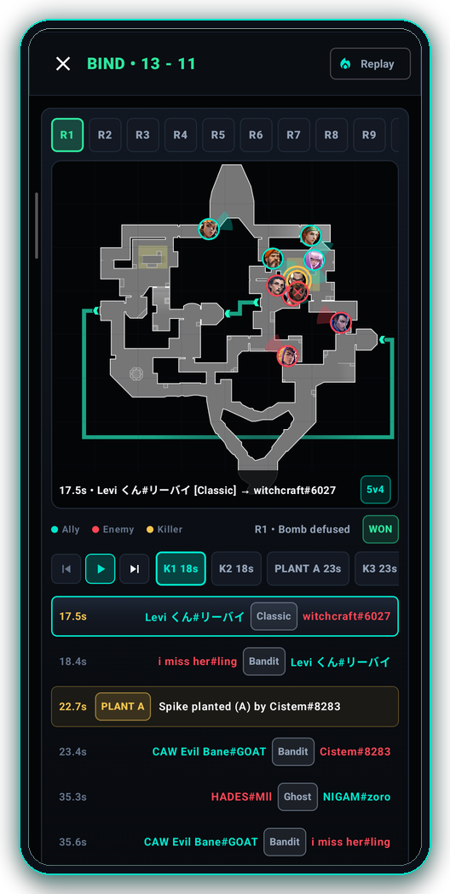
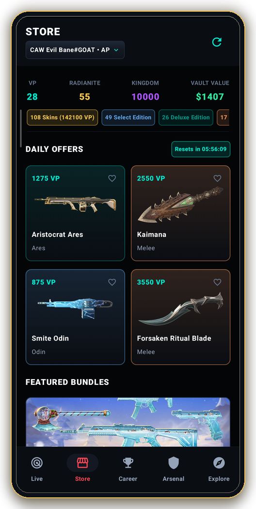
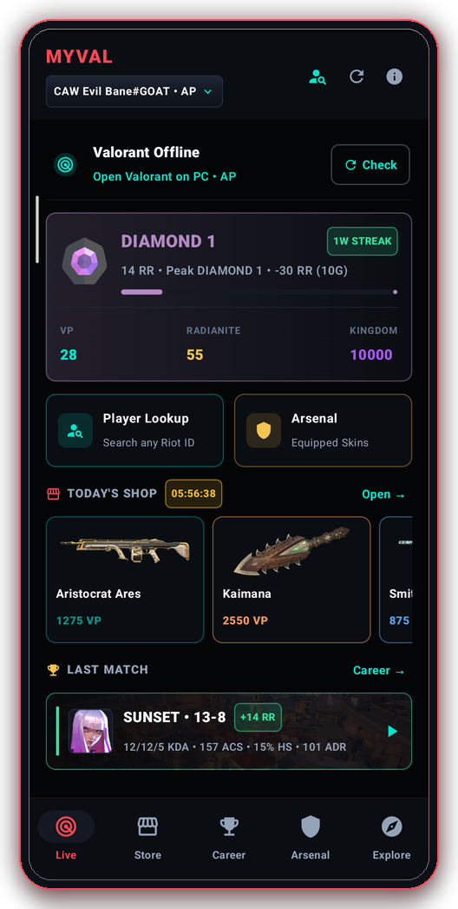
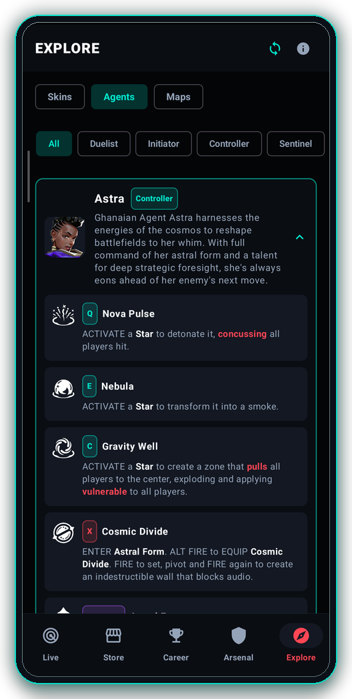

  

<h1 align="center">MyVal — Your Valorant Sidekick for Android</h1>

  <strong>2D Kill-by-Kill Match Replay • Daily Shop &amp; Vault Value • Live Lobby Ranks &amp; Premade Stacks • Remote Skin Swapper</strong>

  
  
  
  

  <a href="https://evil-bane.github.io/MyVal/"><strong>Watch Trailer &amp; Website</strong></a> &nbsp;•&nbsp;
  <a href="https://github.com/Evil-Bane/MyVal/releases/latest"><strong>Download Free APK</strong></a> &nbsp;•&nbsp;
  <a href="#100-safe--ban-free"><strong>Is It Safe?</strong></a> &nbsp;•&nbsp;
  <a href="#install-in-20-seconds"><strong>Install Guide</strong></a>

---

**Stop alt-tabbing out of ranked and stop booting your whole PC just to check your Daily Shop.**
**MyVal** gives Valorant players an unfair-feeling (100% legal) mobile companion — starting with **mobile 2D Kill-by-Kill Match Replays** you won't find in any other companion app.

---

## Screenshots

| 2D Kill-by-Kill Replay | Daily Shop &amp; Vault Value | Live Lobby Ranks |
| :---: | :---: | :---: |
|  |  |  |
| **Remote Skin Swapper** | **RR Graph &amp; Career Stats** | **Agent Abilities &amp; Maps** |
|  |  |  |

---

## Why Valorant Players Love MyVal

### 1. 2D Kill-by-Kill Minimap Replay (Mobile Exclusive)
- **Relive Every Clutch Round:** Scrub through every kill, Spike plant, defuse, and player rotation right on the tactical minimap with live killer/victim highlights and sight cones.
- **Instant Breakdown:** Jump straight to any round (`R1`, `R2`, ...) or event chip (`K1`, `PLANT A`, `DEFUSE`) and tap any player on the scoreboard to inspect their rank history.

### 2. Daily Shop, Night Market &amp; Account Value — From Bed
- **Skip Turning On Your PC:** Check all 4 Daily Store offers, live reset timer, and Night Market cards straight from your phone.
- **Total Vault Value &amp; Wishlist:** Track how many skins you own, see your estimated account VP / dollar value, and star skins for your wishlist.

### 3. Live Lobby Rank Scout &amp; Premade Stack Detector
- **Know Who You're Fighting Before Round 1:** View current Rank, RR, Peak Rank, and **last 5 competitive match dots (Win / Loss / Draw)** for all 10 players in Agent Select and In-Game.
- **Spot Stacks &amp; Skins Instantly:** Automatically detects **Duos, Trios, and 5-Stacks** on both teams, and lets you tap any player to see their equipped weapon skins.
- **Control Your Party &amp; Instalock:** Toggle Ready, queue up, switch modes, hover/lock your Agent in Agent Select, and share or join party invite codes right from Android.

### 4. Remote Skin Swapper, Presets &amp; Explorer
- **Swap Skins Anywhere:** Change equipped weapon skins remotely with real chroma variant art, save unlimited custom loadout presets, or hit **Randomize** in 1 tap.
- **Global Player Lookup, Skins, Agents &amp; Maps:** Search any Riot ID, filter every weapon skin, browse every Agent's `Q`/`E`/`C`/`X` abilities cleanly, and inspect full-size map callouts &amp; minimaps.

---

## 100% Safe &amp; Ban-Free

- **Never Touches PC Game Files or Vanguard:** MyVal runs only on your Android phone. It never modifies files, overlays, or game memory on your PC.
- **Direct Riot Login — No Sketchy Third-Party Servers:** You log in directly on Riot Games' official `auth.riotgames.com` page inside the app. Your login tokens stay encrypted on your phone and are never sent to any relay server.
- **100% Free Forever • Zero Ads:** Built by a Valorant player for Valorant players. No subscriptions, no paywalls, no pop-up ads.

---

## Install in 20 Seconds

### Option 1 — Direct APK Download (Recommended)
1. Download `MyVal-v1.0.0-arm64-v8a.apk` from [**Latest Releases**](https://github.com/Evil-Bane/MyVal/releases/latest) (or via [evil-bane.github.io/MyVal](https://evil-bane.github.io/MyVal/)).
2. Tap the downloaded APK on Android to install.
3. **1-Tap Auto-Update Popups:** MyVal automatically checks for new updates and lets you download them right inside the app.

### Option 2 — Track Updates Automatically with Obtainium
1. Install [**Obtainium**](https://obtainium.imranr.dev/) on Android.
2. Tap **Add App** and paste: `https://github.com/Evil-Bane/MyVal`
3. Obtainium keeps MyVal updated whenever a new release drops.

> **Compatibility:** Android 8.0+ (`arm64-v8a` — works on ~99% of modern Android phones).

Verify Download Checksum (Optional Security Check)

Official releases include `SHA256SUMS.txt` and are signed by `CN=MyVal, OU=Mobile, O=Evil-Bane, C=IN` (`c855b36e0120095bc5ae81f8c7d65724e35775b7b8f4e0ce7c17cc6e959dd16d`). See [SECURITY.md](SECURITY.md) for verification commands.

---

## Legal Disclaimer

MyVal isn't endorsed by Riot Games and doesn't reflect the views or opinions of Riot Games or anyone officially involved in producing or managing Riot Games properties. Riot Games and VALORANT are trademarks or registered trademarks of Riot Games, Inc.
