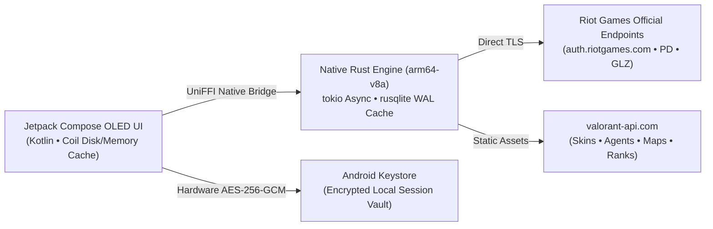

# MyVal — Native Valorant Telemetry & Companion for Android

  
  
  
  

**MyVal** is a pitch-black OLED, zero-middleman Valorant companion for Android powered by a native **Rust telemetry core** (`tokio` + `rusqlite` + `rustls` over UniFFI) and **Jetpack Compose** UI.

> **Website & Direct Download:** [evil-bane.github.io/MyVal](https://evil-bane.github.io/MyVal/) · **Latest APK:** [GitHub Releases](https://github.com/Evil-Bane/MyVal/releases/latest)

---

## Key Features

### Live Match & Agent Select Telemetry
- **10-Player Live Match Scout (`Core-Game`):** Current rank, RR, Peak rank, **last 5 competitive match outcomes (Win / Loss / Draw)**, account level, and real-time lobby average rank.
- **Premade Party & Stack Detection:** Automatically detects Duos, Trios, and 5-stacks in both **Agent Select** and **Live Match**, highlighting grouped players with coordinated accent cards and avatar corner badges.
- **Equipped Skin Inspector:** Tap any player in Agent Select or Live Match to expand their equipped animated, Premium, Exclusive, and Ultra weapon skins (with exact equipped chroma art).
- **Remote Party Controls:** Toggle Ready, start/cancel queue, switch queues, lock/hover agents remotely in Agent Select, and generate/join party invite codes from your phone.

### Store, Night Market & Vault Value
- **Daily Shop & Accessories:** Instant live storefront with countdown timers, VP/Radianite/Kingdom Credits wallet bar, and skin wishlist alerts.
- **Night Market & Collection Vault Value:** Track your total owned skins and estimated account VP value locally.

### Career & 2D Kill-by-Kill Minimap Replay
- **RR Trend & Agent Stats:** Track your recent competitive RR deltas, win rate, K/D, HS%, ACS, and per-agent breakdown.
- **Interactive 2D Match Replay:** Scrub through every round's kills on the tactical minimap with live player positions, view cones, spike plant/defuse markers, and eliminated victim indicators.
- **Global Player Scouting:** Tap any player in a lobby or match scoreboard (or search by Riot ID) to inspect their rank history and match stats.

### Remote Arsenal & Explorer
- **Equip Skins & 1-Tap Randomizer:** Change your active weapon skins from Android (showing your real equipped chroma variant art), save unlimited custom loadout presets, or shuffle owned skins.
- **Explore Skins, Agents & Maps:** Search all Valorant skins by weapon tier with wishlist alerts, browse every agent's Q/E/C/X abilities with clean formatting, and inspect full-size tactical map minimaps.

---

## Architecture

MyVal runs **100% locally on your Android device** with no relay server in between your phone and Riot Games:

---

## Install & Auto-Updates

### Option 1 — Direct APK Download (Fastest)
1. Download the latest `MyVal-vX.Y.Z-arm64-v8a.apk` from [**GitHub Releases**](https://github.com/Evil-Bane/MyVal/releases/latest).
2. Verify the SHA-256 checksum against `SHA256SUMS.txt` (optional).
3. Tap the APK to install.
4. **Built-in Update Popup:** MyVal automatically checks this repository for new signed releases and lets you download updates in 1 tap.

### Option 2 — Automatic Background Updates via Obtainium
1. Install [**Obtainium**](https://obtainium.imranr.dev/) on Android.
2. Add App Source URL: `https://github.com/Evil-Bane/MyVal`
3. Obtainium will automatically track and install every signed release.

> **Compatibility:** Android 8.0+ (`minSdk 26`), 64-bit ARM (`arm64-v8a`, ~99% of modern Android phones).

---

## Zero-Middleman Security & Fair Play

- **No Middleman Backend:** Your Riot RSO sign-in occurs directly inside Riot's official `auth.riotgames.com` login page. Session tokens are encrypted locally with hardware-backed **AES-256-GCM** in Android Keystore and are never transmitted to any third-party server.
- **Read-Only Telemetry & Standard Companion Actions:** MyVal never touches, patches, injects, or modifies Valorant game files or Vanguard.
- See [SECURITY.md](SECURITY.md) for checksum verification and responsible disclosure.

---

## Legal Disclaimer

MyVal isn't endorsed by Riot Games and doesn't reflect the views or opinions of Riot Games or anyone officially involved in producing or managing Riot Games properties. Riot Games, and all associated properties (including VALORANT) are trademarks or registered trademarks of Riot Games, Inc.
