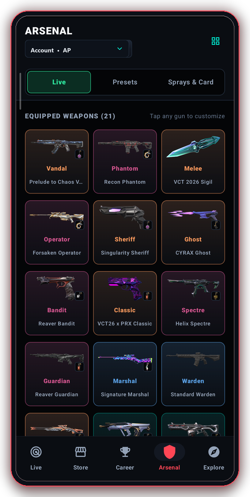
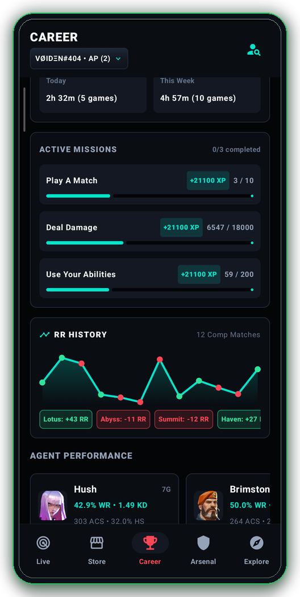

  

<h1 align="center">MyVal — Your Valorant Sidekick for Android</h1>

  <strong>2D Kill-by-Kill Match Replay • Daily Shop &amp; Vault Value • Live Lobby Ranks &amp; Premade Stacks • Remote Skin Swapper</strong>

  
  
  
  

  <a href="https://evil-bane.github.io/MyVal/"><strong>Watch Trailer &amp; Website</strong></a> &nbsp;•&nbsp;
  <a href="https://github.com/Evil-Bane/MyVal/releases/latest"><strong>Download Free APK</strong></a> &nbsp;•&nbsp;
  <a href="#can-users-get-banned"><strong>Can You Get Banned?</strong></a> &nbsp;•&nbsp;
  <a href="PRIVACY.md"><strong>Privacy &amp; Terms</strong></a> &nbsp;•&nbsp;
  <a href="#install-in-20-seconds"><strong>Install Guide</strong></a>

---

**Stop alt-tabbing out of ranked and stop booting your whole PC just to check your Daily Shop.**
**MyVal** gives Valorant players an unfair-feeling (100% legal) mobile companion — starting with **mobile 2D Kill-by-Kill Match Replays** you won't find in any other companion app.

---

## Screenshots

| 2D Kill-by-Kill Replay | Daily Shop &amp; Vault Value | Live Lobby Ranks |
| :---: | :---: | :---: |
|  |  |  |
| **Remote Skin Swapper** | **RR Graph &amp; Career Stats** | **Agent Abilities &amp; Maps** |
|  |  |  |

---

## Why Valorant Players Love MyVal

### 1. 2D Kill-by-Kill Minimap Replay & Filtered Heatmaps (Mobile Exclusive)
- **Relive Every Clutch Round:** Scrub through every kill, Spike plant, defuse, and player rotation on the tactical minimap with **`0.7x` / `1x` / `2x` playback**, live killer/victim highlights, sight cones, **`FB` (First Blood) & `TRD` (Trade) badges**, and **real weapon & ability kill-feed silhouettes**.
- **Filtered Tactical Heatmaps & `DUEL` Stats:** Switch into **Heatmap** mode to filter **Kills, Deaths, First Bloods, or Plants** across **All Rounds / 1st Half / 2nd Half** and **All Players / Allies / Enemies / Individual Agents**, plus per-match **`DUEL X-Y`** records on the scoreboard.

### 2. Daily Shop, Night Market &amp; Account Value — From Bed
- **Skip Turning On Your PC:** Check all 4 Daily Store offers, live reset timer, and Night Market cards straight from your phone with drag-down **pull-to-refresh**.
- **Total Vault Value &amp; Wishlist:** Track how many skins you own, see your estimated account VP / dollar value, and star skins for your wishlist.

### 3. Live Lobby Rank Scout &amp; Verified Premade Stack Detector
- **Know Who You're Fighting Before Round 1:** View current Rank, RR, Peak Rank, and strictly competitive **last 5 match dots (Win / Loss / Draw)** for all 10 players in Agent Select and In-Game.
- **Verified Stacks &amp; Skins Instantly:** Combines GLZ live-party polling and `match-details` `partyId` checks to flag verified **Duos, Trios, and 5-Stacks** cleanly without false-positive solo pairings, and lets you tap any player to inspect equipped skins.
- **Fair-Play Remote Party, Hover &amp; Agent Lock (Anti-Instalock):** Toggle Ready, queue up, switch modes, and share/join party codes — while both **Remote Agent Hover &amp; Lock enforce an explicit 15-second fair-play wait** (`Wait Xs before hovering/locking`) so instant picking or locking for any unfair advantage is strictly disabled.

### 4. Remote Skin Swapper, Presets &amp; Explorer
- **Swap Skins Anywhere:** Change equipped weapon skins remotely with real chroma variant art, save unlimited custom loadout presets, or hit **Randomize** in 1 tap.
- **Global Player Lookup, Skins, Agents &amp; Maps:** Search any Riot ID, filter every weapon skin, browse every Agent's `Q`/`E`/`C`/`X` abilities cleanly, and inspect full-size map callouts &amp; minimaps.

---

## Can Users Get Banned?

- **Has anyone been banned?** **Not happened to anyone we know.** The developer spoke with a Riot developer regarding third-party companion utilities — their verdict was that Riot generally does not mind apps, tools, or scripts unless an automation or feature gives a player a **competitive advantage**. MyVal never automates gameplay, injects overlays, or alters PC files/Vanguard; however, since it uses Riot companion endpoints rather than an official Riot Production API key, we never claim a 100% ban-safe guarantee.
- **Fully Open Source (`GPL-3.0`) &amp; Audit-Friendly:** Inspect the full Rust core (`crates/`) and Android Jetpack Compose UI (`android/`) right in this repository.
- **Direct Riot Login — No Third-Party Relay Server:** You sign in directly on Riot Games' official `auth.riotgames.com` page inside the app. Session tokens stay AES-256 encrypted on your own phone via Android Keystore.
- **100% Free Forever • Zero Ads:** No subscriptions, no paywalls, no pop-up ads.

---

## Install in 20 Seconds

### Option 1 — Direct APK Download (Recommended)
1. Download `MyVal-v1.0.6-arm64-v8a.apk` from [**Latest Releases**](https://github.com/Evil-Bane/MyVal/releases/latest) (or via [evil-bane.github.io/MyVal](https://evil-bane.github.io/MyVal/)).
2. Tap the downloaded APK on Android to install.
3. **Seamless 1-Tap Updates:** Future releases show up inside the app so you can update cleanly in 1 tap.

### Option 2 — Track Updates Automatically with Obtainium
1. Install [**Obtainium**](https://obtainium.imranr.dev/) on Android.
2. Tap **Add App** and paste: `https://github.com/Evil-Bane/MyVal`
3. Obtainium keeps MyVal updated whenever a new release drops.

> **Compatibility:** Android 8.0+ (`arm64-v8a` — works on ~99% of modern Android phones).

Verify Download Checksum (Optional Security Check)

Official releases include `SHA256SUMS.txt` and are signed by `CN=MyVal, OU=Mobile, O=Evil-Bane, C=IN` (`c855b36e0120095bc5ae81f8c7d65724e35775b7b8f4e0ce7c17cc6e959dd16d`). See [SECURITY.md](SECURITY.md) for verification commands.

---

## Open Source, Privacy &amp; Contributing (`GPL-3.0`)

- **Issues &amp; PRs Welcome:** Have a feature idea or found a bug? Open an [Issue](https://github.com/Evil-Bane/MyVal/issues) or submit a Pull Request! Any redistributed builds or modifications must remain open-source under [`LICENSE`](LICENSE) (GNU GPL v3.0).
- **Privacy Policy &amp; Voluntary Terms ([PRIVACY.md](PRIVACY.md)):** MyVal is strictly client-side — we store zero data on external servers, nobody forces sign-in, and users voluntarily authenticate on Riot's own page at their own discretion.

---

## Legal Disclaimer

MyVal isn't endorsed by Riot Games and doesn't reflect the views or opinions of Riot Games or anyone officially involved in producing or managing Riot Games properties. Riot Games and VALORANT are trademarks or registered trademarks of Riot Games, Inc.
